# Echo Shooter v2

**A stealth roguelite in the dark where noise is your weapon.**

Enemies can't see you, they only hear you. So you get loud on purpose and aim them at walls and at each other.

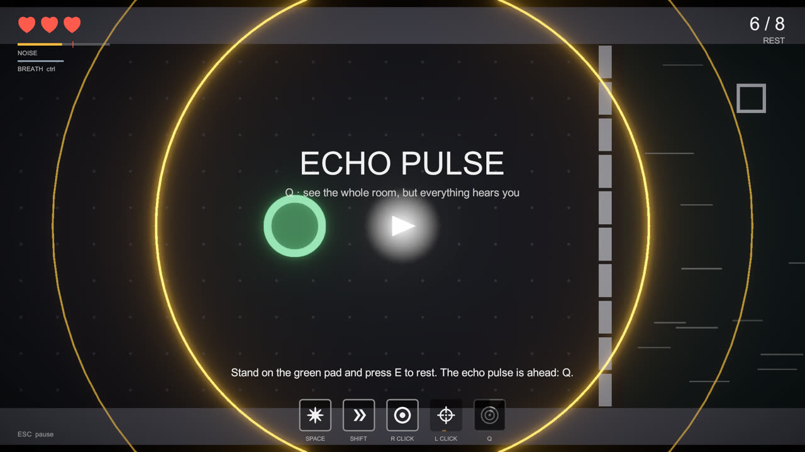

| | |
|---|---|
| **Role** | Solo game designer. Built with Claude (AI) in Unity 6 |
| **Project** | Personal project, Oct 2026 – now |
| **Status** | Playable Unity build: all 8 rooms, start to finish |
| **Scope** | 8 rooms · 4 enemies · 2 sound devices · 5 abilities · 8 charms |
| **Design doc** | 20 sections, 15 mechanic clips, a balance sheet and a change log |
| **v1** | [Play Echo Shooter 2D on itch.io](https://scary-ninja.itch.io/echo-shooter-2d) |
| **Portfolio** | [rohitsy.github.io](https://rohitsy.github.io/#echo-shooter) |

---

## In the Unity build

▶ [Watch the 30 s gameplay highlights](media/highlights-30s.mp4) · ▶ [Watch a full run through all 8 rooms (1:56)](media/full-run.mp4)

Recorded in Unity 6 at 1080p with the game's own synthesised audio (720p copies here).

| | |
|---|---|
| 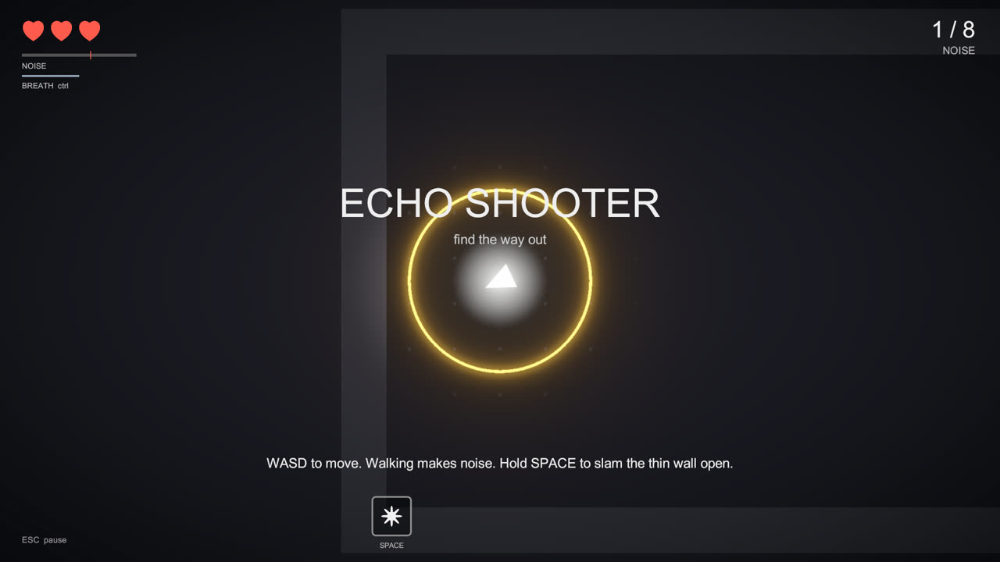 Dark start: your ring is all you can see | 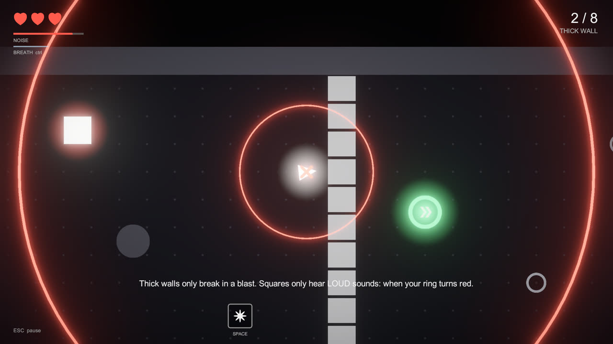 Get loud: the ring turns red and a square marks the spot |
| 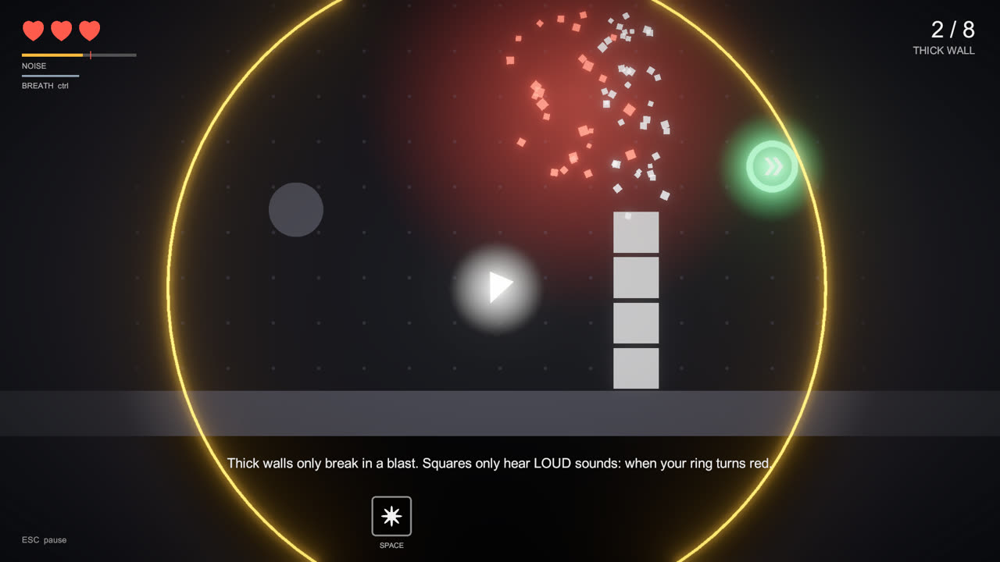 The blast opens the thick wall | 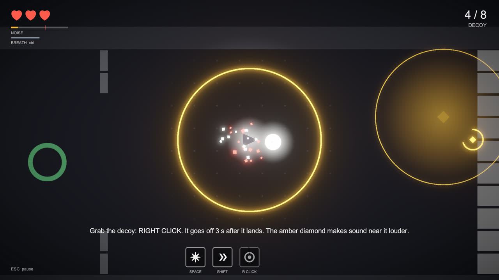 Decoy by the Amplifier, fuse counting down |
| 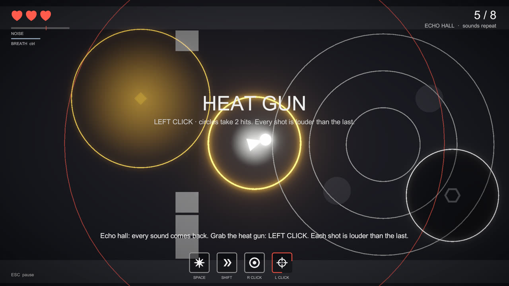 Heat gun in the echo hall: every shot repeats | 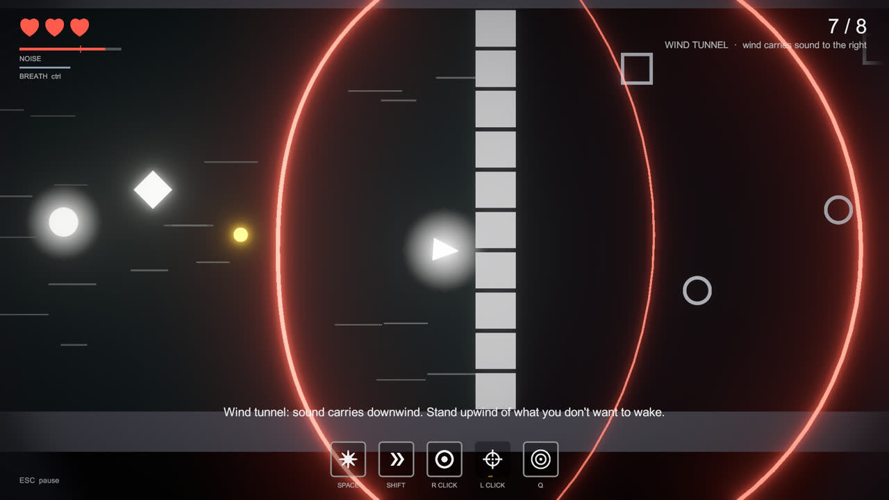 Wind tunnel: the ring bends downwind |
| 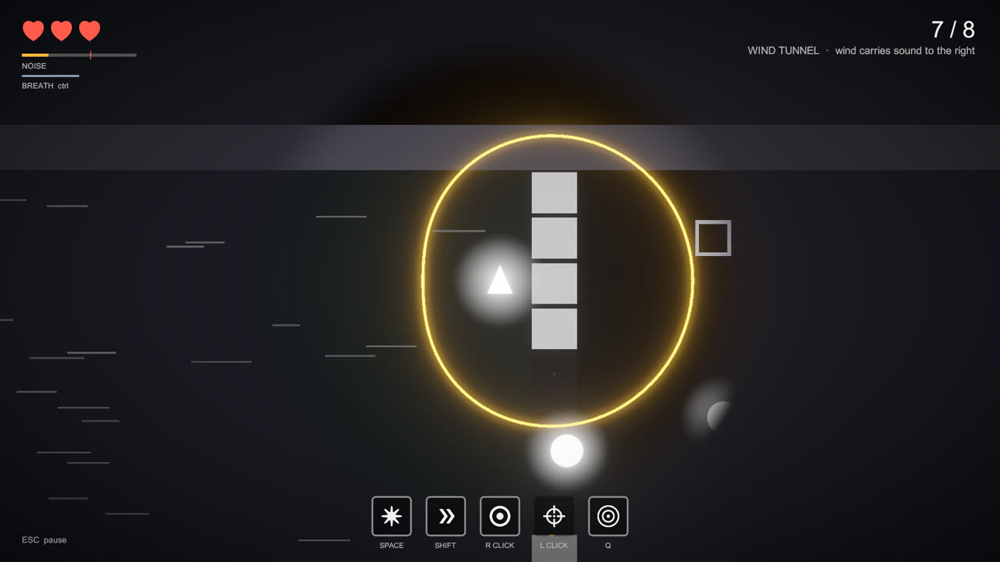 The Mimic replays the slam, louder | 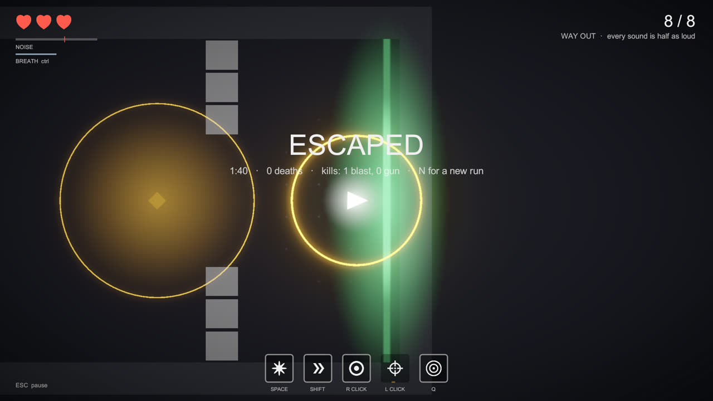 Escaped |

All 22 screenshots, in play order, are in [`screenshots/`](screenshots). The clips further down come from the rules simulation that came before the Unity build.

## Where it came from

Echo Shooter 2D was my college prototyping module: a wave shooter where moving and shooting drew enemies in. v2 is a personal project. It keeps the one idea from v1 that kept pulling me back, that **sound is a signal**, and rebuilds everything else from first principles. Waves are out. Breakable rooms, sound-only enemies and a seeded route are in.

## The core loop

1. **Read the room.** You see 3 tiles around you and nothing else.
2. **Choose how loud to be.** Every action has a sound cost, shown as an amber ring.
3. **Aim the noise.** Wake what you need, where you need it.
4. **Let them do the damage.** You can't attack directly, so enemies break walls and kill each other.
5. **Move on** through the wall you opened, before the room settles.

## How to read the clips

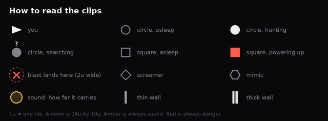

1u is one tile. A room is 16u by 10u. **Amber is always sound. Red is always danger.**

## Rules

| Rule | What it does | Clip |
|---|---|---|
| Noise ring | Your ring is how far you're heard. Standing still it's 2u; walking grows it; it falls at 25 a second | 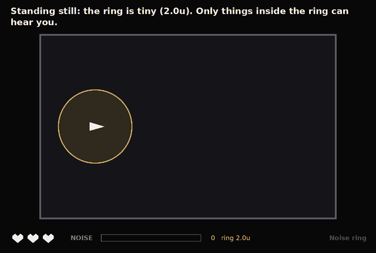 |
| Silent dash | A 3u hop that makes no noise | 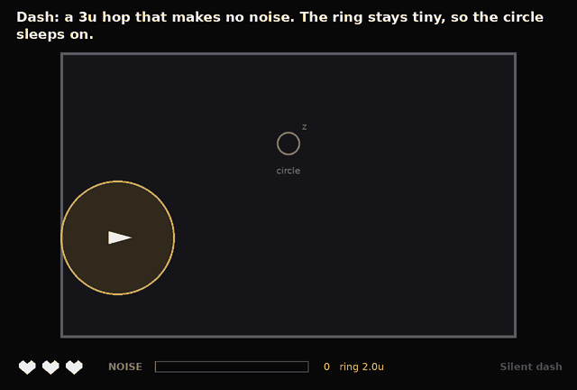 |
| Sound shot | Fire a noise to where you aim. It rings there for 4 seconds | 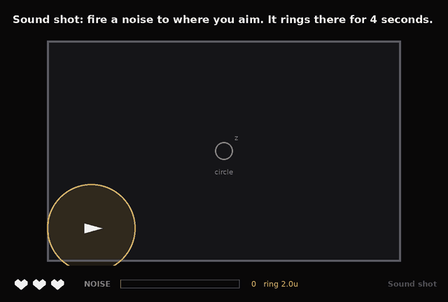 |
| Echo pulse | Lights up the whole room, and the whole room hears it | 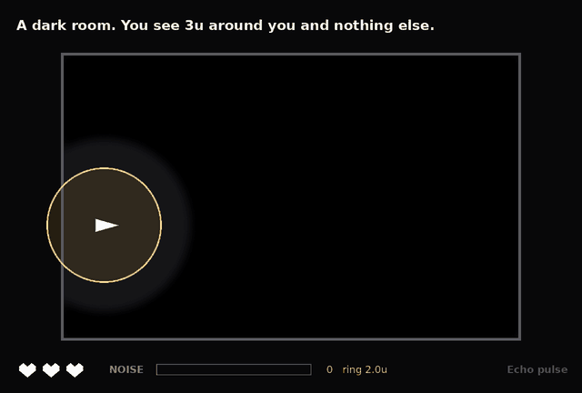 |
| Thin wall | Breaks with a slam or a blast | 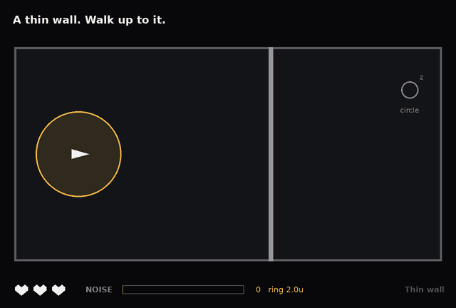 |
| Thick wall | A slam does nothing. Only a blast opens it | 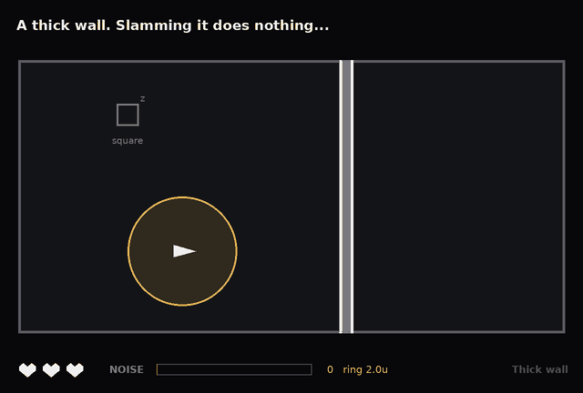 |
| Checkpoint | Rest, heal, push on | 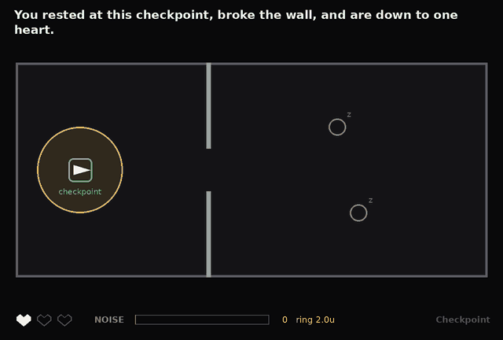 |
| Optional gun | One shot kills one circle from a distance | 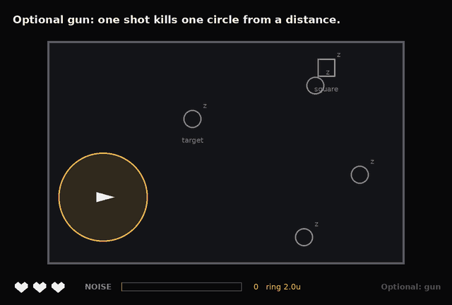 |

## Enemies

| Enemy | Behaviour | Clip |
|---|---|---|
| Circle | Sleeps until your ring touches it, hunts the sound, searches, falls asleep where it stands | 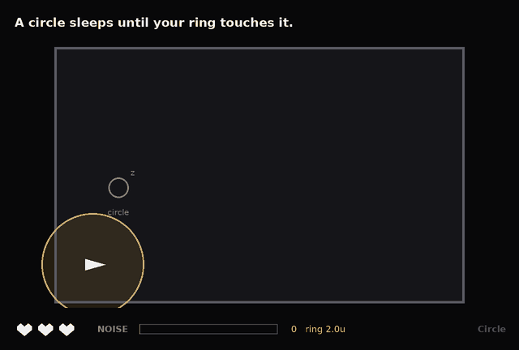 |
| Square | Wakes on a sound you made, locks on, marks the spot and blasts it | 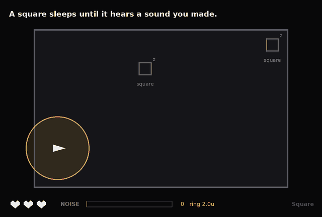 |
| Screamer | Never attacks. It screams and sends everything to where you were | 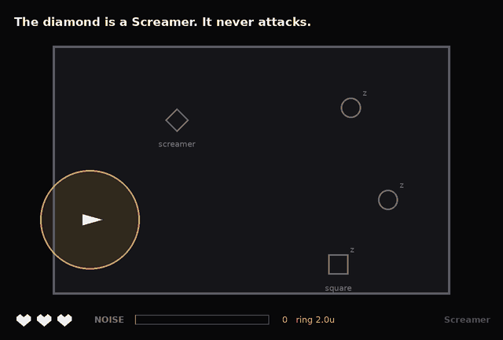 |
| Mimic | Records your noise while it hears you and replays it 3 s later, louder | 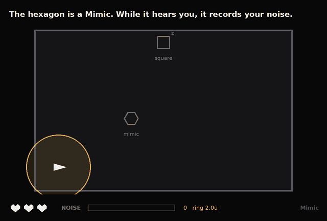 |

**Bait** is the move the whole game is built around: you can't attack, so you lead circles into a square's blast.

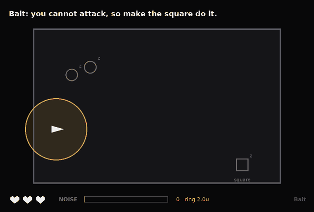

## How a run is built

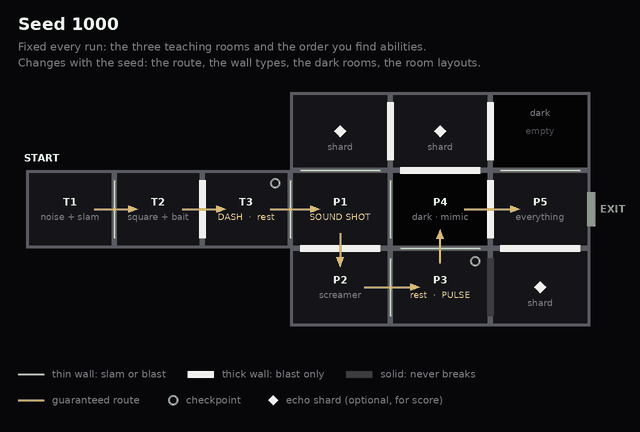

- **Fixed every run:** the three teaching rooms and the order you find abilities.
- **Changes with the seed:** the route, the wall types, the dark rooms and the room layouts.
- Every map is checked with a flood fill so a route always exists.

## Numbers that changed the design

| What | Before | After | Why |
|---|---|---|---|
| Noise fall rate | 8 / s | **25 / s** | At 8, escaping a chaser took 20 tiles of dashing in a 16-tile room |
| Unwinnable maps | 68 of 2,000 | **0** | The first map rule could seal the route; replaced with a flood-fill check |
| Heat gun burst | — | **4th shot = 72** | The 4th shot is the first one squares hear (threshold 60), so 3 shots are safe |

## How it was built with AI

| | Rohit | Claude |
|---|---|---|
| **Idea** | The original game, the expansion sketch, the core rules (noise, circles, squares, breakable walls) | Research on similar games and what tends to work |
| **Design** | Every decision, from rounds of multiple-choice questions: the rules, room themes, the gun, charms | Proposed options and trade-offs, flagged weak spots, wrote up the design doc |
| **Numbers** | Approved every change | Ran the balance sums and the simulation; logged each change with its reason |
| **Build** | Playtesting and final calls | All code: the Python simulation, the Unity game, and the editor bridge it tests with |

### Process

**Sketch → rules → simulation → design doc → Unity**

1. Turned one sketch ("escape the boxes") into written rules with numbers.
2. Tested those rules in a ~300-line Python simulation (870 with the drawing code) that produced every rules clip here, before any Unity code.
3. Let the numbers overrule the idea when they disagreed (see the table above).
4. Wrote it all into a 20-section design doc with a balance sheet and a change log.
5. Built it in Unity 6: about 5,000 lines of C# in 30 files, with every visual and sound made in code and no art files.

▶ [Watch the full mechanics reel (2 min 22 s)](media/mechanics-reel.mp4)

## Status

| Piece | Status |
|---|---|
| Rules, simulation and the 15 clips | Done |
| Design doc | Done (PDF coming) |
| Unity build | Plays all 8 rooms, start to finish |
| Gameplay footage | Full run and 30 s highlight reel recorded |
| Browser build and trailer | Next |

---

Made by **Rohit Yentruvi**, game designer · [Portfolio](https://rohitsy.github.io) · [v1 on itch.io](https://scary-ninja.itch.io/echo-shooter-2d)
